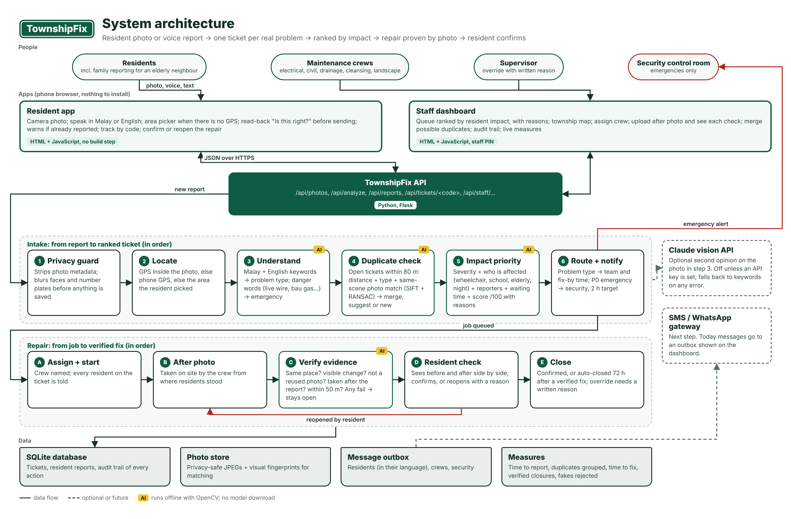
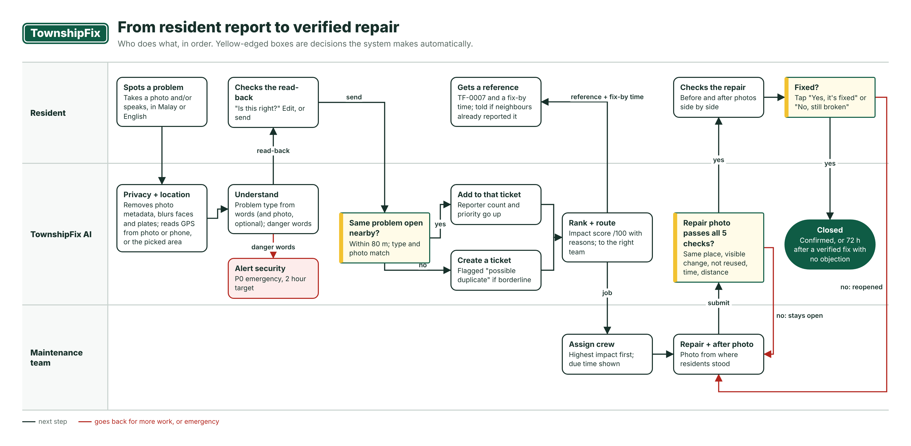

# TownshipFix

**Turn resident complaints into completed, verified repairs.**
Sime Darby Property University Hackathon 2026, PEOPLE track (Safety & Security, Digital Living, Accessibility & Inclusion).

Residents snap a photo or simply *say* what is broken, in Malay or English. TownshipFix:

1. **Groups duplicate reports.** Three neighbours photographing the same dark streetlight become one job, not three.
2. **Ranks jobs by impact on residents.** A ramp blocked for wheelchair users near a clinic outranks a full bin, and the score shows its reasons.
3. **Proves the fix.** A job only closes when the crew's *after* photo passes five checks and the resident confirms it (or doesn't object within 3 days).





## Run it (5 minutes)

Needs Python 3.10 or newer.

```bash
git clone <this repo> && cd townshipfix
python -m venv .venv && source .venv/bin/activate      # Windows: .venv\Scripts\activate
pip install -r requirements.txt
python run.py
```

- Resident app: http://localhost:8000
- Staff dashboard: http://localhost:8000/staff (PIN `1234`)

**On a phone**, connect to the same Wi-Fi and run `python run.py --https`, then open the
`https://<laptop-ip>:8000` address it prints and accept the certificate warning.
Phones only allow the microphone and GPS on HTTPS pages.

### Fill it with demo data

```bash
python scripts/synthetic_photos.py                                   # generated test scenes
python scripts/load_demo.py demo_photos/_synthetic --complete        # 15 reports -> 5 tickets -> verified repairs
python scripts/load_demo.py --complete                               # your real photos in demo_photos/
```

## The 2-minute demo

1. Phone 1 (Bahasa Melayu): photo of the broken streetlight, say *"Lampu jalan rosak, gelap waktu malam"*.
   The app reads it back: *"Saya faham: Lampu jalan rosak… Betul?"* Send, and you get plate **TF-0001**.
2. Phones 2 and 3 photograph the same lamp from other angles. Before sending they see
   *"Already reported by 1 neighbour (TF-0001)… photo match 96%"*. Still one ticket, now 3 reporters, higher priority.
3. A resident reports *"exposed wire sparking at the playground"*: P0 emergency, security alerted, top of the queue.
4. Staff dashboard: open TF-0001, see the three photos and **why it ranks where it does**. Assign a crew.
5. Upload a photo of a *different* place as the "after" photo. **Rejected**: scene match 17%, 277 m away.
6. Upload the real after photo. **Accepted**: same place, 1% of the scene changed (the lamp), new photo, taken after the report, 7 m away.
7. Resident's phone: before and after side by side, tap **Yes, it's fixed**. Measures update.

Screenshots of every step are in [`docs/screenshots`](docs/screenshots).

## What the AI does, honestly

| Job | How | Runs offline? |
|-----|-----|---------------|
| Understand the report | Malay + English keyword rules (incl. Manglish), danger words, impact words like *kerusi roda*, *warga emas*, *gelap* | Yes |
| Optional photo opinion | Claude vision API, only if `ANTHROPIC_API_KEY` is set; falls back to keywords on any error | No (optional) |
| Same problem? | Distance + problem type + **same-scene photo match** (SIFT keypoints + RANSAC geometry) | Yes |
| Repair really done? | Align after photo onto before photo, cancel lighting changes, measure how much of the scene changed | Yes |
| Privacy | Strips photo metadata always; blurs faces and number plates with OpenCV's detectors when installed | Yes |
| Voice | Phone's built-in speech recognition (`ms-MY`, `en-MY`) and read-aloud | On the phone |

The resident always confirms the problem type with one tap, and staff see every score's reasons.
Nothing is a black box.

**Accuracy so far:** on generated test scenes, 100% of same-problem photo pairs matched, 0 of 90
different-problem pairs matched, 15/15 real repairs were accepted and 35/35 fake ones rejected
([report](docs/evaluation_synthetic.md)). **Generated scenes are easier than real photos.** Run
`python scripts/evaluate_images.py` on real photos (see [`demo_photos/README.md`](demo_photos/README.md));
it reports accuracy and suggests new thresholds for `app/config.py`.

## Measures (shown live on the dashboard)

- **Time to report** (median seconds from opening the app to sending)
- **Duplicate reports grouped** (jobs avoided)
- **Time to fix** (median hours from report to closure)
- **Closures with verified evidence** (photo-checked and confirmed, vs. supervisor override)
- **Weak repair photos rejected** (fake or premature closures blocked)

## Tests

```bash
python -m unittest discover -s tests -t . -v      # 55 tests: language, vision, privacy, priority, full flows
python tests/browser_e2e.py                        # clicks through both apps in a headless browser (needs playwright)
```

GitHub Actions runs the tests and the photo check on every push (see the Actions tab).

## Project layout

```
app/
  api.py                 HTTP endpoints
  config.py              every threshold, category, team and zone in one place
  services/
    text_nlp.py          Malay/English understanding, danger + impact words, read-back
    classifier.py        problem type (keywords, optional Claude vision)
    vision.py            photo matching and change detection (OpenCV)
    privacy.py           metadata removal, face/plate blur
    dedup.py             duplicate decision with explanation
    priority.py          impact score with reasons
    verification.py      the five repair checks
    tickets.py           ticket lifecycle
    notify.py, metrics.py
  static/                resident app (index.html) and staff dashboard (staff.html), no build step
scripts/                 synthetic photos, demo loader, photo evaluation
demo_photos/             put real photos here (guide inside)
docs/                    architecture, flow, screenshots, reports
tests/
```

## Limits and next steps

- **Thresholds are tuned on generated scenes.** Real photos with heavy parallax, rain or night shots
  need the evaluation script and probably new values.
- **Messages are simulated** (dashboard outbox). Next: WhatsApp Business / SMS gateway.
- **One township per install**, with sample zones. Next: a `township_id` on tickets for multi-township rollout.
- **Staff sign-in is a shared PIN**. A pilot needs per-person accounts.
- Voice relies on the phone's speech recognition; strong dialects may need typing.

## Research behind it

- Residents least able to use reporting apps report fewer problems; see the 311 visibility audit
  (*Sustainability* 2026, doi:10.3390/su18147500) and the 311 underreporting study (*Annals of Applied Statistics*).
- Poorly maintained walkways and inaccessible infrastructure limit older adults' and disabled people's
  mobility (*Cities* review of 60 studies, 2026).
- Voice assistants suit many older adults but need customisation and error handling
  (*Universal Access in the Information Society* 2026 review).
